# 从 0 手写神经网络：前向传播 → 反向传播 → MNIST 分类

不调框架，只用 NumPy，把「神经网络到底在算什么」一路写到手写卷积层，
在 MNIST 上从 **92.69%（线性）→ 97.98%（全连接）→ 99.12%（卷积）**。
全连接版本 10 轮约 **25 秒**，卷积版本 10 轮约 **285 秒**，每一步都有能直接运行的命令。
再把同一套代码原样搬到 **EMNIST balanced（47 个数字+字母）**，看它在"更难的分类任务"上
从 **83.90%（全连接）→ 87.36%（卷积）**，以及为什么剩下的 13 个点有一大半不是模型的锅。
最后一步换成 **CIFAR-10（32×32 彩色照片）**：全连接 **49.69%**，两层卷积 **76.87%**——
同一份数据上差 27 个点，差的正是"能不能看见局部结构"。

---

## 你会得到什么

| 文件                        | 作用                                                                                       | 什么时候跑 |
| --------------------------- | ------------------------------------------------------------------------------------------ | ---------- |
| `mnist.py`                | 下载/解析 MNIST 原始二进制，转成 `(60000, 784)` 的数组                                   | 全程用     |
| `nn.py`                   | 神经网络库：`Linear` / `ReLU` / `SoftmaxCrossEntropy` / `MLP` / `SGD` / `Adam` | 全程用     |
| `step1_forward.py`        | 只做前向传播，打印每一步的中间结果                                                         | 第 1 节    |
| `step2_gradient_check.py` | 反向传播 + 数值梯度校验（含"故意写错"的反例）                                              | 第 4 节    |
| `step3_train_mnist.py`    | 完整训练闭环，出 loss/准确率曲线                                                           | 第 6 节    |
| `step4_predict.py`        | 加载模型，出混淆矩阵、错误样本、权重可视化、显著性图                                       | 第 7 节    |
| `predict_image.py`        | 拿一张自己的图做推理                                                                       | 第 8 节    |
| `experiments.py`          | 结构/优化器对照实验，复现第 10 节的表格                                                    | 第 10 节   |
| `conv.py`                 | 手写卷积：`Conv2D`(im2col) / `MaxPool2D` / `CNN`                                     | 第 12 节   |
| `step5_gradcheck_conv.py` | 卷积 + 池化的梯度检验（含"池化写错"反例）                                                  | 第 12 节   |
| `step6_train_cnn.py`      | 训练 CNN，出曲线、卷积核、与 MLP 对比图                                                    | 第 12 节   |
| `emnist.py`               | 下载/解析 EMNIST，取 balanced（47 类）并扶正图像                                           | 第 13 节   |
| `step7_train_emnist.py`   | 同一套网络换 47 类数据重跑，出混淆矩阵/每类准确率                                          | 第 13 节   |
| `cifar10.py`              | 下载/解析 CIFAR-10（16 万条 pickle），含通道标准化与随机裁剪/翻转增强                      | 第 14 节   |
| `step8_train_cifar10.py`  | 同一数据集上 MLP vs 两层卷积的对照实验                                                     | 第 14 节   |
| `figures/`                | 上面脚本生成的所有图                                                                       | —         |
| `models/mlp_mnist.npz`    | 全连接权重（97.98%）                                                                       | —         |
| `models/cnn_mnist.npz`    | 卷积权重（99.12%）                                                                         | —         |
| `models/mlp_emnist.npz`   | EMNIST 全连接权重（83.90%）                                                                | —         |
| `models/cnn_emnist.npz`   | EMNIST 卷积权重（87.36%）                                                                  | —         |
| `models/mlp_cifar10.npz`  | CIFAR-10 全连接权重（49.69%）                                                              | —         |
| `models/cnn_cifar10.npz`  | CIFAR-10 两层卷积权重（76.87%）                                                            | —         |

建议顺序：**先读本文档 → 再逐条跑命令**。每个脚本的注释里都写了"这里为什么要这么写"。

---

## 0. 准备环境

本目录是 `01step` monorepo（uv workspace，Python 3.12）的一个成员，虚拟环境在仓库根目录统一维护：

```bash
cd 01step                 # 仓库根目录
uv sync --all-packages    # 首次：一次装齐三个子项目的依赖
cd NN_step
```

之后跑任意脚本用 `uv run python xxx.py`（Windows 同样写法）。在子目录里直接 `uv run` 即可，
uv 会自动识别所属 workspace 并同步本目录的依赖。
MNIST 数据会在第一次运行时自动下载到 `data/mnist/`，约 11 MB，之后走本地缓存。

依赖声明在本目录 `pyproject.toml`：NumPy、Matplotlib、Pillow。
CIFAR-10 第一次从 parquet 转换需要 pyarrow（`data/cifar10/` 里已有 `.npz` 缓存后不再需要）：
`uv sync --all-packages --package nn-step --extra parquet`。

> 本机实测环境：Python 3.12 + NumPy 1.26，float64，Apple Silicon 的 BLAS。
> 共享环境里 numpy 固定在 1.x 是因为 `LoRA_step` 锁了 `numpy<2`；本目录代码同时兼容 2.x。

---

## 1. 前向传播：神经网络到底在算什么

### 一句话版本

一张 28×28 的手写数字图，被拉平成 784 个数；网络把这些数**反复做「加权求和 + 非线性」**，
最后压成 10 个数（每个类别一个分数），再用 softmax 变成 10 个概率。

### 形状是理解一切的钥匙

| 步骤    | 计算                         | 输入形状                | 输出形状                |
| ------- | ---------------------------- | ----------------------- | ----------------------- |
| 输入    | `X`                        | —                      | `(N, 784)`            |
| 第 1 层 | `z1 = X @ W1 + b1`         | `(N,784) @ (784,256)` | `(N, 256)`            |
| 激活    | `a1 = max(z1, 0)`          | `(N,256)`             | `(N, 256)`            |
| 第 2 层 | `z2 = a1 @ W2 + b2`        | `(N,256) @ (256,10)`  | `(N, 10)`             |
| softmax | `p = softmax(z2)`          | `(N,10)`              | `(N, 10)`，每行和为 1 |
| 损失    | `L = -mean(log p[i, y_i])` | `p, y`                | 标量                    |

`N` 是这一次送进去的样本数（batch size）。网络里所有运算都是"对每个样本独立做一遍"，
所以矩阵乘法天然支持并行——这不是优化技巧的产物，而是 **batch 维度可以随便加** 的必然结果。

### 跑一下

```bash
uv run python step1_forward.py
```

脚本前半段用一个 3→4→2 的小网络、手算级别的整数权重，把每一步都打印出来：

```
输入 x         形状 (3,) = [ 0.5 -1.   2. ]
第1层 Linear   z1 = x@W1 + b1
  x@W1 = [ 4.5  -1.    3.25 -3.5 ]
  +b1   = [ 4.5   0.    2.75 -3.5 ]          形状 (4,)
ReLU 激活      a1 = [4.5  0.   2.75 0.  ]     <- 两个负数被砍成 0
第2层 Linear   z2 = a1@W2 + b2 = [-1.   -1.25]
Softmax        p = [0.5622 0.4378]  概率和=1.0000
交叉熵损失     loss = -log(p[1]) = 0.8259
```

**为什么值得手算一遍**：`z1[0] = 0.5*1.0 + (-1.0)*(-2.0) + 2.0*0.5 + 0 = 4.5`——
一个神经元的输出，就是它接收的所有输入按权重加权求和。整个"深度学习"最底层就是这一件事，
剩下的都是这件小事的堆叠和自动化。

后半段换成真实尺寸（`784 → 256 → 10`）跑 8 张图，你会看到：

```
输出 probs (8, 10)  每行加起来 = 1.0
未训练时每行概率都接近 1/10=0.100 —— 模型在瞎猜
对应 loss ≈ -ln(1/10) = 2.3026  <- 训练开始时的 loss 就该是 2.30 左右
```

记住 **2.30** 这个数。它是你以后排查所有训练问题时的第一道体检：初始 loss 不是 2.3 左右，
基本就是数据没归一化、标签错了、或者网络最后少了一层/多了一层。

---

## 2. 损失函数：为什么是 softmax + 交叉熵

模型输出的是 10 个**任意实数**（logits），要变成"概率"，用 softmax：

```
p_k = exp(z_k) / Σ_j exp(z_j)
```

预测得越"自信"，对应 logit 越大，概率越接近 1。然后拿**正确类别的概率**算交叉熵：

```
L = -(1/N) Σ_i log p[i, y_i]
```

- 猜对了（`p[y] ≈ 1`）→ `-log(1) = 0`，没有惩罚；
- 猜错了（`p[y] ≈ 0`）→ `-log(0) → ∞`，惩罚极大。

**为什么不用 MSE？** 因为 softmax+MSE 的梯度里会带一个 `p(1-p)` 因子：
当模型错得很离谱（`p[y]≈0`）时这个因子也接近 0，梯度几乎消失，学得极慢。
交叉熵正好把这个因子约掉了，错得越狠梯度越大。

代码里有个细节：

```python
z = logits - logits.max(axis=1, keepdims=True)   # 先减最大值再 exp
```

`exp(1000)` 会直接变成 `inf`，然后 `inf/inf = nan`，整个训练当场报废。减去每行最大值
在数学上完全等价（分子分母同乘一个常数），但保住了数值稳定。这是第一个"必须记住"的工程细节。

---

## 3. 反向传播：把链式法则写成矩阵

### 先看一层，再看整个网络

对一个线性层 `z = x @ W + b`，损失 `L` 对它的三个量求梯度：

| 要什么           | 公式               | 形状         | 直觉                                         |
| ---------------- | ------------------ | ------------ | -------------------------------------------- |
| 对权重的梯度     | `dW = X^T @ G`   | `(in,out)` | 每个样本的输入 × 它造成的误差，再按样本求和 |
| 对偏置的梯度     | `db = Σ_n G[n]` | `(out,)`   | 偏置对每个样本都贡献一次，所以求和           |
| 传给上一层的梯度 | `dX = G @ W^T`   | `(N,in)`   | 把误差按权重"分摊"回每个输入                 |

其中 `G = dL/dz` 是从下一层传上来的梯度。

**为什么 `dW = X^T @ G` 而不是 `X @ G`？** 因为 `W[i,j]` 被**每一个样本**用到过（它出现在所有
样本的第 j 个输出上）。所以 `dW[i,j] = Σ_n X[n,i] * G[n,j]` —— 这正是 `X^T @ G` 的定义。
`X^T` 的形状 `(in, N)` 和 `G` 的 `(N, out)` 一乘，样本维度被**求和消掉**，剩下 `(in, out)`。
记住这条：**梯度公式里出现转置，都是因为那个维度被"跨样本累加"了。**

### 整个网络的反向，只有 8 行

```python
d = self.p.copy()                     # d = p - onehot(y)，再除以 N（因为 loss 是 batch 平均）
d[np.arange(len(y)), y] -= 1.0
g = d / len(y)                        # (N, 10)   <- 这就是 dz2

for layer in reversed(self.layers):
    g = layer.backward(g)             # Linear: dW=X^T@g, db=Σg, 返回 g@W^T
                                      # ReLU:   g * (x > 0)
```

展开写就是：

```
dz2 = (p - Y) / N          # 最漂亮的一步：softmax+交叉熵的梯度只差一个 p - onehot
dW2 = a1^T @ dz2           # (256,10)
db2 = Σ_n dz2              # (10,)
da1 = dz2 @ W2^T           # (N,256)
dz1 = da1 * (z1 > 0)       # ReLU 的导数：正数区间是 1，负数区间是 0
dW1 = X^T @ dz1            # (784,256)
db1 = Σ_n dz1              # (256,)
```

### 为什么 `dL/dlogits = p - y`？

只用一个样本推：

```
L = -z_y + log(Σ_k exp(z_k))          # 把 -log p_y 展开
∂L/∂z_k = -[k == y] + exp(z_k)/Σ_j exp(z_j) = p_k - [k == y]
```

对正确类别减 1，其余类别就是它自己的概率。矩阵形式下 `Y` 是 one-hot，所以 `p - Y`。
含义很直观：**每个类别的 logit 该往哪调，取决于"当前概率比目标概率高多少"**。

### 反向传播到底在省什么

如果不用反向传播，你也可以对 20 万个参数逐个做数值微分——每个参数要跑两次完整前向，
6 万样本 × 20 万参数，纯属自杀。反向传播一次前向 + 一次反向就拿到**全部**梯度，
代价只有前向的两倍左右，因为它复用了前向时缓存的中间量（`x`、`z1`、`mask`）。
这就是 `nn.py` 里每层都要 `self.x = x`、`self.mask = x > 0` 的原因——**缓存是为了反向用**。

---

## 4. 梯度检验：写完反向传播，先别信自己

链式法则推错、转置写反、忘了乘 mask，代码**照样能跑**，只是 quietly 不收敛。
唯一可靠的检查办法是 **梯度检验**（gradient check）：

```
数值梯度 = (L(θ + ε) - L(θ - ε)) / (2ε)        # 中心差分，误差 O(ε²)
```

把它和解析梯度比，看相对误差：

```
rel_err = |a - n| / max(1e-8, |a| + |n|)
```

判读标准（float64）：

| 相对误差    | 结论                                       |
| ----------- | ------------------------------------------ |
| < 1e-6      | 完美，可以放心训练                         |
| 1e-6 ~ 1e-4 | 基本可信（float32 或 ε 选得不好会到这档） |
| > 1e-2      | 一定有 bug，别往下走                       |

```bash
uv run python step2_gradient_check.py
```

实测输出（网络 8-6-10，batch=5，全量校验 124 个参数）：

```
正确实现
  W1 (8, 6)   1.23e-07
  b1 (6,)     3.04e-09
  W2 (6, 10)  8.44e-08
  b2 (10,)    8.56e-09
  -> 最大相对误差 1.23e-07  通过
```

脚本还会故意制造两个 bug，让你看到梯度检验怎么"抓现行"：

```
BUG: 忘了除以 batch size     全部参数 6.67e-01
BUG: 忘了 ReLU mask           W1/b1 1.00e+00，但 W2/b2 仍然 8.4e-08（正常）
```

第二个反例特别值得看：**漏掉 ReLU mask 只影响 ReLU 之前的参数，不影响它之后的。**
因为反向传播是从后往前流的——下游算错了，上游看不出来。这既说明"梯度流的方向"这件事，
也说明梯度检验要覆盖**每一层**，只查最后一层是查不出上游 bug 的。

---

## 5. 训练循环：batch、学习率、优化器

训练的本质只有一句话：**反复"猜 → 算错多少 → 按梯度反方向修正一点点"**。

```python
for epoch in range(epochs):
    perm = rng.permutation(n)                 # 每轮打乱
    for i in range(0, n, batch_size):
        idx = perm[i:i+batch_size]
        logits = model.forward(X[idx])        # 1. 前向
        loss   = loss_fn.forward(logits, y[idx])  # 2. 算损失
        model.backward()                      # 3. 反向，梯度写进各层 dW/db
        opt.step()                            # 4. 沿负梯度方向更新
```

四个工程细节，每个都对应一个常见 bug：

1. **mini-batch**：一次只喂 64 张。全量 6 万张算一次梯度太慢且内存吃紧；单张又噪声太大。
   64/128 是性价比甜点。
2. **shuffle**：不打乱的话，模型会顺着样本顺序"背题"，泛化变差。
3. **学习率 `lr`**：步子大小。太大 loss 震荡甚至 NaN，太小 loss 肉眼看不见下降。
   Adam 下 `1e-3` 几乎是万能起点。
4. **epoch**：完整过一遍训练集的轮数。

参数更新用的是 **Adam**（`nn.py` 里 20 行）：

```
m = 0.9*m + 0.1*g                     # 梯度的一阶矩（动量）
v = 0.999*v + 0.001*g²                # 二阶矩（梯度大小）
m̂ = m/(1-0.9^t),  v̂ = v/(1-0.999^t)  # 偏差修正（前几步别被 0 初始化拖偏）
θ = θ - lr * m̂ / (√v̂ + ε)            # 每个参数用自己的尺度走
```

它比 SGD 好的地方是：梯度大的参数自动步子小，梯度小的自动步子大，所以对学习率不敏感。
代价是要多存两倍的动量数组。想理解"动量"就记住一句话：**像小球滚下山，之前的方向会保留一部分，
所以能冲过平缓区、也能抑制来回震荡**。

---

## 6. 在 MNIST 上跑通全流程

```bash
uv run python step3_train_mnist.py
```

实测（784-256-10，He 初始化，Adam lr=1e-3，batch=64，float64）：

| epoch | train loss | train acc | test acc | 耗时 |
| ----- | ---------- | --------- | -------- | ---- |
| 1     | 0.2560     | 96.46%    | 95.48%   | 2.6s |
| 2     | 0.1064     | 98.08%    | 97.29%   | 2.6s |
| 3     | 0.0715     | 98.78%    | 97.66%   | 2.6s |
| 4     | 0.0518     | 99.00%    | 97.68%   | 2.6s |
| 5     | 0.0395     | 99.26%    | 98.00%   | 2.6s |
| 6     | 0.0306     | 99.22%    | 97.78%   | 3.0s |
| 7     | 0.0224     | 99.56%    | 97.86%   | 2.7s |
| 8     | 0.0176     | 99.46%    | 98.08%   | 2.7s |
| 9     | 0.0153     | 99.80%    | 97.96%   | 2.7s |
| 10    | 0.0107     | 99.82%    | 97.98%   | 2.7s |

**10 轮共 27.1 秒，测试集 97.98%（10000 张错 202 张）。**

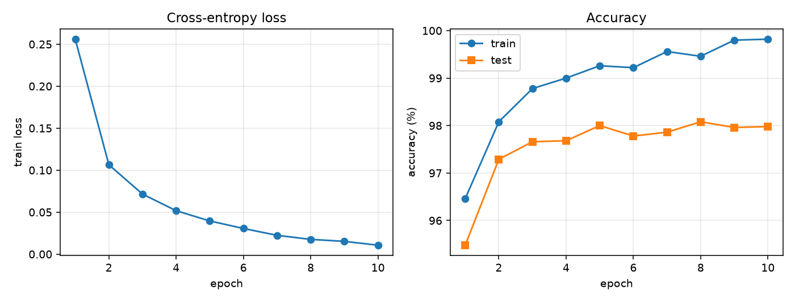

从这张图能读出三件事，比准确率本身更重要：

- **第 1 轮就到 95.5%**。因为 MNIST 对 MLP 来说太"简单"了：像素本身就把信息摆得很直白，
  不需要任何空间结构先验。
- **第 5 轮之后 test acc 基本不动，train acc 还在涨**（99.3% → 99.8%）。
  这说明开始轻微过拟合了：模型在背训练集，没能转化成泛化能力。10 轮是这个规模下的合理停止点。
- **loss 还在降但准确率不涨**，说明它在把"已经答对的题答得更自信"——
  交叉熵会奖励这种自信，但分类准确率不会因此提高。这两个指标本来就不是一回事。

想更快跑一遍（3 轮就有 97.6%）：`--epochs 3`；想试更宽：`--hidden 512`。

---

## 7. 看它到底学到了什么

```bash
uv run python step4_predict.py
```

会产出 4 张图，每张都对应一个具体问题。

### (1) 错在哪：混淆矩阵

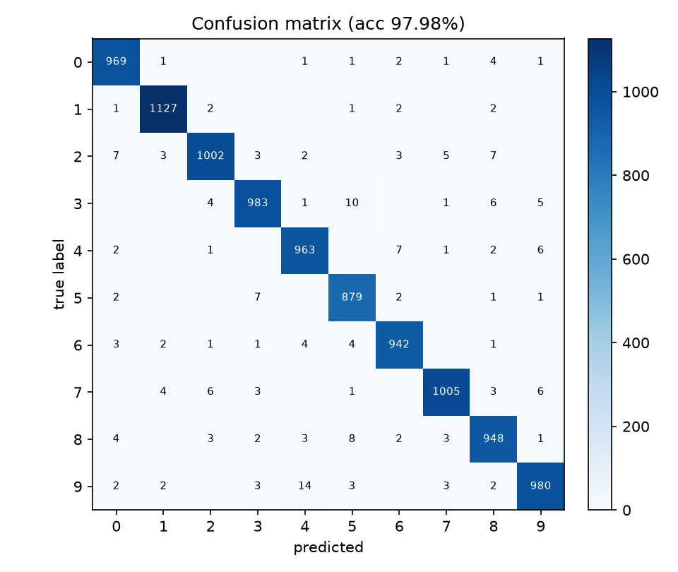

对角线以外的数字就是错误。最容易混的 5 对（真实 → 预测）：

| 真实 | 预测 | 张数 |
| ---- | ---- | ---- |
| 9    | 4    | 14   |
| 3    | 5    | 10   |
| 8    | 5    | 8    |
| 5    | 3    | 7    |
| 4    | 6    | 7    |

`9→4` 和 `4→6` 都是"竖线 + 一个圈/一个尖角"的结构相似；`3→5`、`8→5` 在潦草的写法下
上半部分几乎一样。**这些错误是有意义的**：它们不是随机的，而是说明模型的"特征"还不够细。

### (2) 错的样子：错误样本

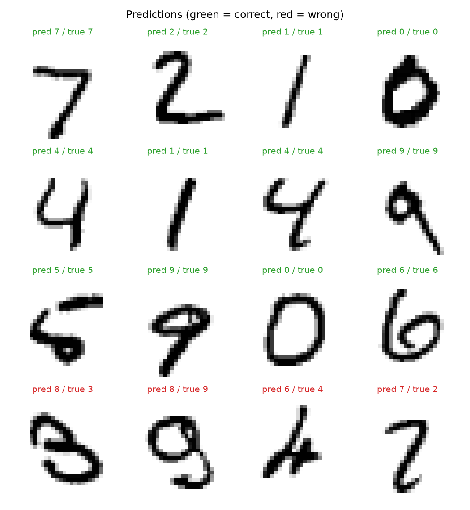

12 张猜对 + 4 张猜错（红字）。看那 4 张就明白了：`3` 写得像 `8`、`9` 的圈没封口、
`4` 的两个笔画断开、`2` 带了个多余的勾。**这些样本人看着也费劲，模型错得不冤。**
真正该警惕的是"人一眼能认出、模型却错"的样本——那才是模型缺陷。

### (3) 第一层学到了什么

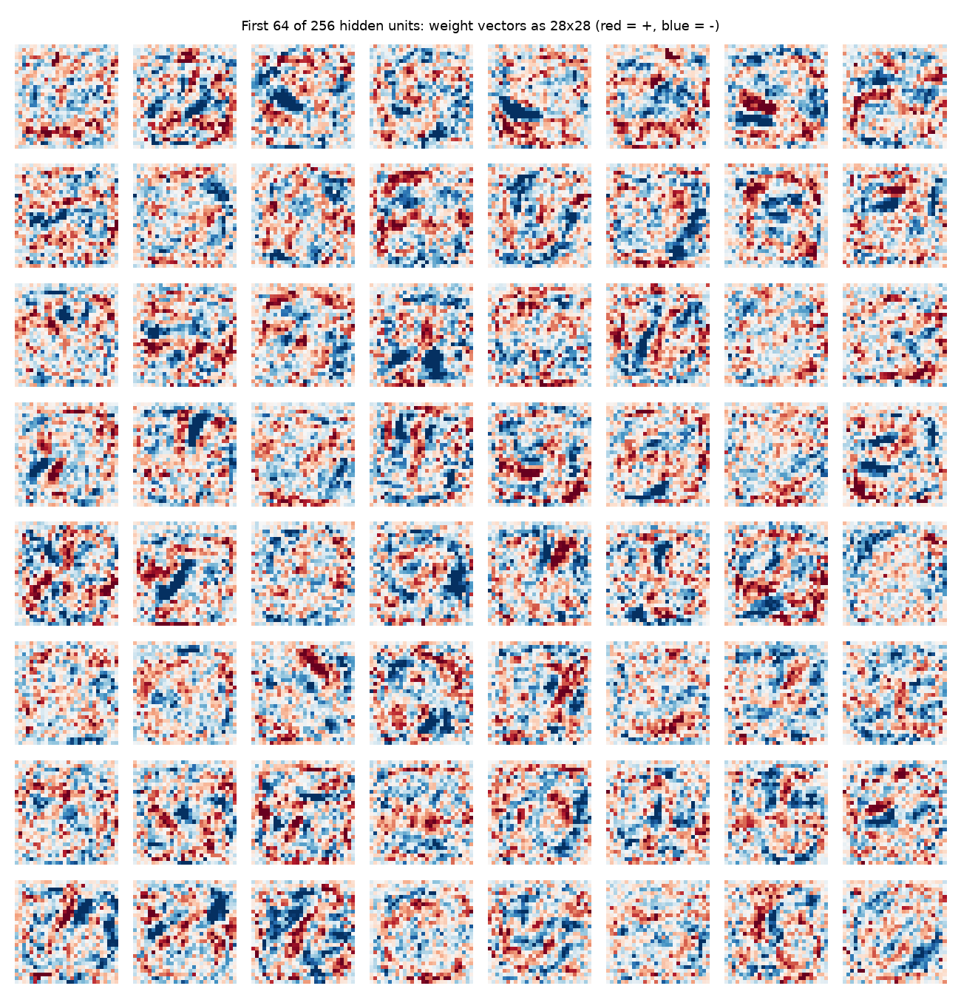

每个隐藏单元有 784 个权重，重排成 28×28 就是它"长什么样"。红色是正权重（这个位置有笔画
就该被激活），蓝色是负权重（这个位置有笔画反而该抑制）。

坦白说：**它不像卷积网络那样能看出清晰的边缘检测器**，更多是弥散的、带点整体形状倾向的模板。
这是全连接层的固有特点——它的每个神经元都看全部 784 个像素，没有"局部性"和"平移不变性"的
先验，只能自己勉强调出来。这正是下一步该学卷积的**动机**，而不是一句"MLP 不够强"的空话。

### (4) 反向传播还能用来解释模型

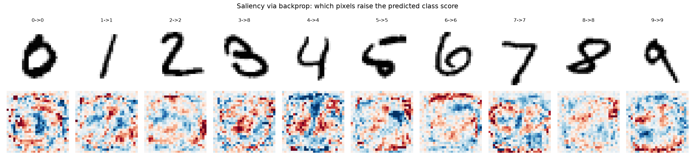

给"预测类别"的 logit 一个梯度 1、其余为 0，往前跑一遍 backward，得到 `d(分数)/d(像素)`。
红色像素表示"这些位置变亮会让模型更确信当前判断"。这就是显著性图（saliency map）。

同样要坦白：MLP 的显著性图很碎。因为 ReLU 网络是**分段线性**的，它的梯度在相邻像素间跳变，
不像 CNN 那样平滑。这个技术的价值和局限都在这一张图里——它能给一个方向，但别拿它当解释。

---

## 8. 拿自己的图试一次

```bash
uv run python predict_image.py data/sample_digit.png
```

`predict_image.py` 做的预处理：读图 → 转灰度 → 归一化到 0~1 → 最近邻缩放到 28×28 →
送入网络。输出会把送进网络的 28×28 图像用字符画打出来，**这一步一定要看**——
90% 的"明明写得对却识别错"都是预处理错了（比如白底黑字没反转、图没居中、比例被拉伸）。

```
预测：2   置信度 100.0%
Top-3：2(100.0%)  1(0.0%)  0(0.0%)
```

如果是白底黑字的扫描件/截图，加 `--invert`，因为 MNIST 是**黑底白字**：

```bash
uv run python predict_image.py 我的数字.png --invert
```

自己拍照的图会明显变差——MNIST 的数字是居中的、笔画粗细均匀、28×28 已经裁好。
真实手写照片需要先做"二值化 + 找外接框 + 居中 + 缩放"这一套（这叫预处理流水线），
本教程故意不包进来，因为它属于工程问题，不属于"神经网络原理"。

---

## 9. 十六个坑（附症状和改法）

| #  | 症状                                       | 原因                                                               | 改法                                                        |
| -- | ------------------------------------------ | ------------------------------------------------------------------ | ----------------------------------------------------------- |
| 1  | 初始 loss ≈ 8.0 或 200+                   | 像素没归一化到 0~1                                                 | `X / 255.0`                                               |
| 2  | 报 `IndexError: index 784 out of bounds` | 标签被 one-hot 了却当索引用                                        | 索引用 int 标签，算 loss 用 one-hot                         |
| 3  | loss 直接 NaN                              | softmax 没减最大值                                                 | `exp(z - z.max(1, keepdims=True))`                        |
| 4  | loss 下降极慢                              | 忘了除 `N`，等效 lr 放大了 64 倍                                 | 确认 `(p - Y) / N`                                        |
| 5  | 每一轮准确率都卡在 10%                     | 隐藏层全零初始化，所有神经元学到同一个东西                         | He 初始化 `std=sqrt(2/in)`                                |
| 6  | 训练集 99%、测试集 90%                     | 过拟合 / 用测试集调了超参                                          | 早停、加正则、划分验证集                                    |
| 7  | loss 上下大幅震荡                          | lr 太大                                                            | 除以 10 再试；Adam 从 1e-3 起                               |
| 8  | 一半神经元输出恒为 0（"死 ReLU"）          | lr 太大，负区间一次被推死且梯度为 0 再也活不过来                   | 降 lr；换 LeakyReLU/GELU                                    |
| 9  | 梯度检验通过但训练不收敛                   | 检验用了 float64、训练用了 float32 的 eps 不匹配                   | 检验时统一 float64，`eps=1e-4`~`1e-6`                   |
| 10 | 加载模型后预测全一样                       | 存权重时没存网络结构（`sizes`）                                  | 结构一起存，或加载后 assert 形状                            |
| 11 | 准确率比预期低 1~2%                        | 忘了 shuffle，或最后一轮没用到零头样本                             | 每轮 `permutation`；`range(0, n, bs)`                   |
| 12 | 训练完 accuracy 变差                       | 在训练集上评估（同一个数据集既训又测）                             | 永远在没参与训练的 `X_test` 上评估                        |
| 13 | 卷积训练 loss 不降                         | `col2im` 写成了赋值（`dx[...] = ...`），梯度没在重叠像素上累加 | 改成 `+=`，并用 `step5` 的 `dX` 那一行验证            |
| 14 | 卷积层参数梯度全错                         | im2col 的列顺序 `k*k*C` 和 `W` 的行顺序不一致                  | 两边都用 `(k, k, C)` 展开，跑一次梯度检验确认             |
| 15 | 池化后准确率反而变低                       | 池化反向没用 `argmax`，把梯度平均分给了窗口里 4 个位置           | 正向存 `argmax`，反向只往那个位置放梯度                   |
| 16 | 算出来的通道均值三通道一模一样             | 1.5 亿个数用 float32 累加，低位全被吃掉                            | `mean(..., dtype=np.float64)`；上亿个数的统计一律 float64 |

---

## 10. 练手清单（按难度排）

先把这张表跑出来（`uv run python experiments.py`，约 3 分钟），它就是"什么在起作用"的答案：

| 配置（10 轮，其余相同）               | 测试准确率       | 耗时  |
| ------------------------------------- | ---------------- | ----- |
| 线性模型 784-10（无隐藏层、无非线性） | 92.69%           | 4.4s  |
| 窄隐藏层 784-32-10                    | 96.68%           | 7.6s  |
| **基线 784-256-10**             | **97.98%** | 25.8s |
| 宽隐藏层 784-512-10                   | 98.13%           | 45.4s |
| 双层 784-256-128-10                   | 97.88%           | 31.1s |
| 基线换 SGD+momentum(0.1)              | 97.86%           | 20.6s |

四个能直接读出来的结论：

- **非线性贡献了 5.3 个百分点**（92.69% → 97.98%）。线性模型只能给每个类别画一张"加权模板"，
  `9` 和 `4` 这种形近字它分不开——这是"为什么需要激活函数"最直接的证据。
- **宽度有边际递减**：32 → 256 加了 1.3 个点，256 → 512 只加了 0.15 个点，耗时却翻了 1.8 倍。
- **深度在这个任务上没用**（双层 97.88% 反而略低）。MNIST 的判别边界不需要很深的组合特征，
  加层只是在增加过拟合风险。**"更深更好"是有条件的**，别当信仰。
- **SGD+动量能和 Adam 打平**（97.86% vs 97.98%），但前两轮明显更慢。Adam 的价值在"少调参"，
  不是"上限更高"。

然后自己动手改，每个都值得亲眼看一下：

1. **把 lr 设成 0.1**（Adam）：看 loss 怎么炸，亲手制造一次 NaN，以后就知道这长什么样。
2. **删掉归一化**（`X` 不除 255）：看初始 loss 怎么冲到几百，以及为什么梯度检验通过也没用。
3. **宽度扫描 32 / 128 / 256 / 512**：自己算一下"每提升 0.1 个点要付多少秒"。
4. **换优化器**：`SGD(lr=0.1, momentum=0.9)` 对比 Adam，观察前 2 轮的收敛速度差异。
5. **加第二隐藏层**（`sizes=(784, 256, 128, 10)`）：把宽度换一换再看，深度到底在什么条件下有用。
6. **加权重衰减**（`W -= lr*(dW + λ*W)`）：看 train acc 和 test acc 的差距怎么缩小。
7. **手写一个 LeakyReLU**（`x if x>0 else 0.01*x`），导出梯度公式，然后用 `step2` 的方法检验它。
8. **给 CNN 加第二层卷积**：在 `conv.py` 的 `CNN.__init__` 里再插一组
   `Conv2D(32→64, 5x5) + ReLU + MaxPool2D(2)`，第一层权重维度记得改成 2x2 池化后的尺寸。
   学 LeNet 的两层卷积结构，看能不能再挤出 0.2 个点。
9. **关掉平移增强**（`--augment 0`）跑一遍，和默认结果对比——亲眼看数据增强值多少个点。

做完 1~5，你对"什么在起作用"就有了肌肉记忆，而不是背下来的结论。

---

## 11. 下一步学什么

- **卷积网络（CNN）**：已经写完了，见第 12 节（99.12%）。第一层权重会变成方向性的边缘检测器，
  和第 7 节的 `filters.png` 对比着看，差异一眼可见。
- **批归一化 / Dropout**：两个几乎不增加计算量的稳定训练手段。
- **换框架**：同样的网络用 PyTorch 就是十几行

  ```python
  # 参考写法（本机未安装 torch，仅示意）
  net = nn.Sequential(nn.Flatten(), nn.Linear(784, 256), nn.ReLU(),
                      nn.Linear(256, 10))
  opt = torch.optim.Adam(net.parameters(), lr=1e-3)
  loss_fn = nn.CrossEntropyLoss()          # 内部已含 softmax，别再手动加
  ```

  框架帮你自动做了本文档第 3 节的所有推导（autograd），但**你得知道自己省的到底是什么**，
  否则调不动模型。这也是本教程不直接上框架的原因。

---

## 12. 进阶：手写卷积层，把 97.98% 推到 99.12%

第 7 节那张 `filters.png` 埋了一个伏笔：全连接层的"第一层特征"是一团弥散的像素权重。
原因很简单——**它的每个神经元都盯着全部 784 个像素，而且每个像素配一个独立的权重**。
MNIST 里"数字 3"在左上角和右下角是同一个概念，但全连接层要为这两个位置各学一套参数，
既浪费参数，也学不出"平移不变"。

卷积用两步解决它：

1. **局部连接**：每个神经元只看 5×5 的窗口（25 个像素），不再看全图；
2. **权重共享**：同一组 5×5 权重在图的 24×24 个位置滑动，全图复用。

```bash
uv run python step5_gradcheck_conv.py   # 先验证卷积的反向写对了
uv run python step6_train_cnn.py        # 再训练（10 轮约 285 秒）
```

### 12.1 im2col：卷积其实是一次矩阵乘法

卷积的定义是「窗口与卷积核逐元素相乘再求和」，写起来是一堆循环。工程上的做法是 **im2col**：

```
x    (N, 28, 28, 1)
  -> 每个 5x5 窗口里的 25 个像素拉成一列
cols (N, 24, 24, 25)  -> reshape 成 (N*576, 25)
W    (25, 32)          # 32 个卷积核，摊平成 25 行
out  = cols @ W        # (N*576, 32) -> reshape (N, 24, 24, 32)
```

原本"24×24 个位置各做一次 25 维内积"，变成了一次 `(N*576, 25) @ (25, 32)` 的矩阵乘法。
好处有两个：喂给 BLAS 就能跑满 CPU；**反向传播直接复用第 3 节推过的公式**——
`dW = Aᵀ G` 那一套，一个字都不用改。

`conv.py` 里的 `_im2col` 就是 25 次切片赋值（k×k 个偏移各取一次），没有任何魔法。

### 12.2 卷积的反向，只有三条

| 要什么   | 公式                     | 和第 3 节的关系                                      |
| -------- | ------------------------ | ---------------------------------------------------- |
| 权重梯度 | `dW = colsᵀ @ G`      | 和 `dW = Xᵀ G` 完全同一个式子，只是 X 换成了 cols |
| 偏置梯度 | `db = Σ G`            | 不变                                                 |
| 输入梯度 | `dX = col2im(G @ Wᵀ)` | 新的：要把梯度"撒"回原图                             |

**`col2im` 是这里唯一的新东西，也是最容易写错的地方**：相邻窗口在图像上会重叠，
一个中间像素会被多个窗口用到，所以梯度必须**累加**（`+=`）而不是赋值（`=`）。
写成赋值，代码照样跑，只是训练不收敛。

### 12.3 池化：正向取 max，反向只给 max 那个位置

2×2 最大池化把 `(N,28,28,32)` 压成 `(N,14,14,32)`。反向时，梯度只应该流向"当初取到最大值"
的那个位置，其余三个位置是 0。所以正向要把 `argmax` 存下来（这就是"缓存中间量为了反向"的又一个例子），
反向用 `np.put_along_axis` 把梯度放回去。

### 12.4 新结构照样先过梯度检验

```bash
uv run python step5_gradcheck_conv.py
```

实测（8×8 → conv3×3(3) → pool2 → fc5，float64）：

```
conv.W  (9,3)       3.42e-09
conv.b  (3,)        2.40e-10
fc.W    (27,5)      1.69e-08
fc.b    (5,)        1.33e-09
dX      (2,8,8,1)   2.65e-08      <- 这一行专门检验 col2im 的累加逻辑
```

`dX` 通过，说明 im2col 的列顺序和 `W` 的行顺序一致、col2im 也在正确累加。
脚本里还有个反例：**把池化梯度平均分给 4 个位置**，结果是 `conv.W` 误差 1.00（全错），
而 `fc.W` 仍然 1.69e-08（正常）——又一次印证了"梯度是从后往前流的，下游错了上游才报错"。

### 12.5 训练：为什么先掉进过拟合，再加正则

第一版我直接换成卷积（16 个核、不加任何正则），8 轮结果：

```
train_acc 99.72%    test_acc 98.71%
```

**准确率比 MLP 高了，但 train/test 差了整整 1 个百分点**——这是典型的过拟合。
换结构不等于变好，模型容量上去了，就得配上约束。于是：

| 手段                 | 作用                                                         |
| -------------------- | ------------------------------------------------------------ |
| 卷积核 16 → 32      | 给足容量（32 个核 = 832 个参数，见下）                       |
| 平移增强 ±2 像素    | 告诉模型"数字挪一挪还是这个数字"，等价于凭空多出几倍训练数据 |
| 权重衰减 `wd=1e-4` | 惩罚过大的权重，压住过拟合                                   |
| 第 6 轮学习率减半    | 后期步子变小，才能落进更窄的极小值                           |

最终 10 轮（conv32+fc128，592,074 个参数，Adam lr=1e-3）：

| epoch | train loss | train acc | test acc         | 耗时  |
| ----- | ---------- | --------- | ---------------- | ----- |
| 1     | 0.0801     | 98.00%    | 98.13%           | 28.5s |
| 2     | 0.0584     | 98.56%    | 98.50%           | 28.1s |
| 3     | 0.0496     | 98.68%    | 98.47%           | 29.4s |
| 4     | 0.0418     | 98.78%    | 98.46%           | 28.6s |
| 5     | 0.0345     | 98.96%    | 98.81%           | 29.1s |
| 6     | 0.0271     | 99.32%    | 99.10%           | 28.5s |
| 7     | 0.0302     | 99.08%    | 99.04%           | 28.5s |
| 8     | 0.0225     | 99.22%    | **99.12%** | 28.3s |
| 9     | 0.0177     | 99.38%    | 99.11%           | 28.0s |
| 10    | 0.0154     | 99.50%    | 99.06%           | 28.3s |

**最佳 99.12%，脚本会把最好那一轮的权重存下来**（不是最后一轮——第 10 轮已经比第 8 轮低，
这说明走到后期 test acc 开始抖，早停是有必要的）。

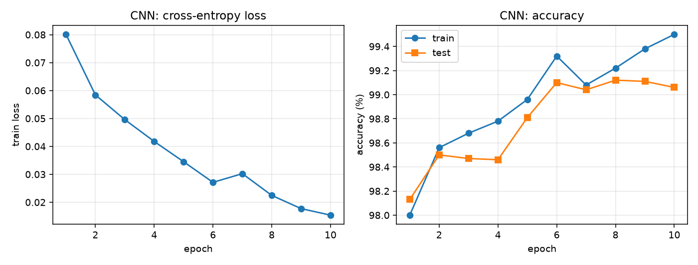

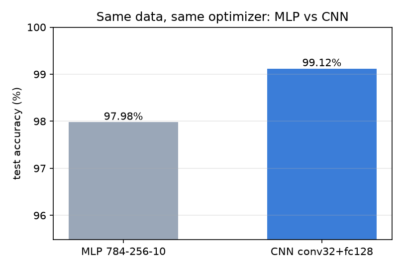

涨点主要来自两块，大致可以这样拆：**换卷积 +0.7% 左右**（98.71 vs 97.98），
**容量 + 正则 + 增强再 +0.4%**。不要以为"换个结构就自动变强"。

### 12.6 代价：慢了 11 倍

10 轮从 25 秒变成 285 秒。原因不是参数量（卷积层只有 832 个参数，比 MLP 第一层的 20 万个还少），
而是**计算量**：32 个核 × 576 个位置 × 64 张图 = 每批 118 万次乘加，
而且 `(64*576, 25) @ (25, 32)` 这种"瘦高矩阵"在 BLAS 上远不如 `(64,784) @ (784,256)` 高效。
真实的框架里这块由 cuDNN 专门优化过的卷积算法接管，所以 PyTorch 里同样一层卷积比你手写的快几十倍。

### 12.7 它在找什么：对比一下就明白了

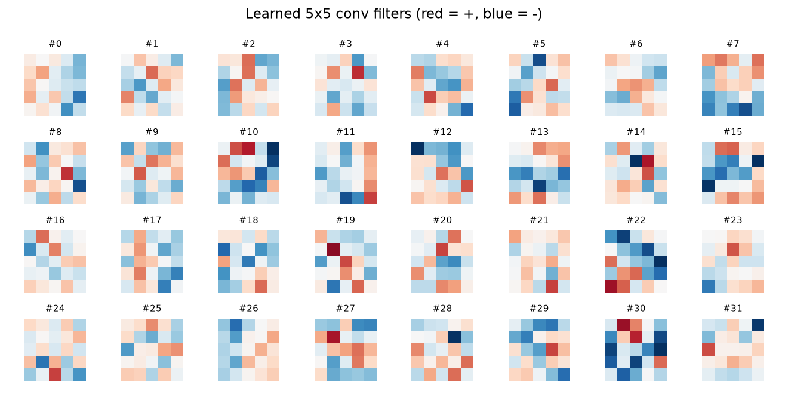

32 个 5×5 卷积核，每个只有 25 个权重。能看出明显**方向性**：有的核是"左暗右亮"（竖向边缘），
有的是斜向的笔画响应，有的负责角落。和第 7 节 MLP 那 64 张弥散的图放一起对比，
"局部 + 共享"到底买到了什么就一目了然了。

同样要说实话：这仍是一层卷积，只能学到**一阶边缘**。真正的"组合特征"（边缘→笔画→部件→数字）
需要叠第二层卷积、并在中间加池化。这也就是为什么完整的 LeNet 是两层卷积两层全连接。
以现在这套代码为底，加第二层就是 `conv.py` 里再塞一个 `Conv2D + ReLU + MaxPool2D` 的事——
留作练习。

### 12.8 单图推理现在也支持 CNN

```bash
uv run python predict_image.py data/sample_digit.png                              # MLP，100.0%
uv run python predict_image.py data/sample_digit.png --model models/cnn_mnist.npz  # CNN，99.9%
```

脚本会看权重文件里有没有 `config` 键来自动判断是 MLP 还是 CNN，不需要你手动指定类型。

---

## 13. 换数据：EMNIST balanced，47 类

MNIST 只有 10 个数字，练完容易产生"我这套代码挺强"的错觉。换一个更难的字母数据集，
同样的 `nn.py` / `conv.py` 一行不改，只改**输出维度**和**数据加载**，就能看出：
网络结构没变、优化器没变，**精度掉下来是因为任务本身变难了**。

```bash
uv run python emnist.py                                  # 先看一眼数据有没有读对
uv run python step7_train_emnist.py                      # 默认 8+8 轮，约 8 分钟
```

EMNIST balanced：47 类 = 10 个数字 + 37 个字母类（52 个大小写字母里，15 对写法完全相同的被合并成 1 类），
训练 112,800 / 测试 18,800，每类正好 2400 张。

### 13.1 两个必须处理的坑

**坑 1：图像是转置的。** EMNIST 的 28×28 按 (列, 行) 顺序存。直接 `reshape(28,28)` 出来，
字符是躺倒的；更阴险的是——**模型照样能学，只是永远学不好**（相当于让它认旋转 90° 的字）。
`emnist.py` 里一行搞定：

```python
imgs = data.reshape(n, 28, 28).transpose(0, 2, 1)   # 转置扶正
```

看到 `r`、`a`、`n` 是正立的那一刻，才算数据读对了。

**坑 2：标签基数因 split 而异。** 本项目的 `balanced` 标签本来就是 0..46；而 `letters` /
`byclass` / `bymerge` 是 1 起始，要减 1。写死 `-1` 或写死 `不减`，换 split 时都会悄悄错一位，
症状是**训练 loss 能降、准确率却卡在很低**。加载器按 `labels.min()` 判断，不靠记忆。

**新的体检基准**：47 类的初始 loss 是 `ln(47) ≈ 3.85`，不是 2.30。实测 3.96，
差值来自随机初始化的有限样本估计，正常。

### 13.2 结果

| 模型                  | MNIST（10 类） | EMNIST balanced（47 类） | 每轮耗时 |
| --------------------- | -------------- | ------------------------ | -------- |
| MLP 784-256-47        | 97.98%         | **83.90%**         | ~5 s     |
| CNN conv5x5(32)+fc128 | 99.12%         | **87.36%**         | ~54 s    |

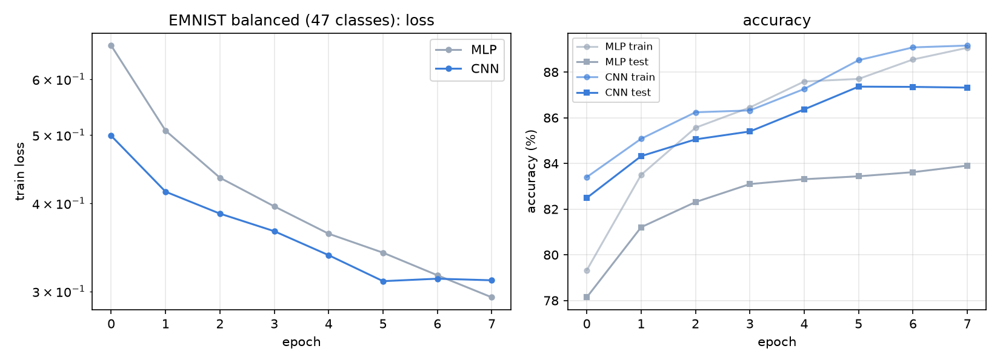

两个模型都还是"卷积 > 全连接"，差距从 1.1 个点扩大到 3.5 个点：
**类别越多，局部结构越值钱**——字母的区分靠的是笔画拐角，不是像素的绝对位置。

### 13.3 错在哪：混淆矩阵要开 log

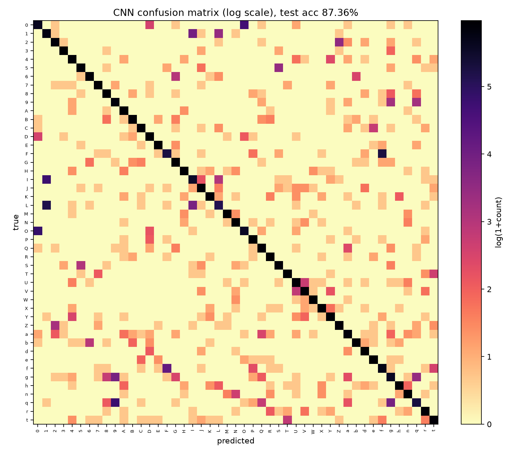

47×47 的矩阵，对角线之外大部分格子都是 0，线性色标下什么都看不见，所以用 `log1p` 上色。
前几名混淆（真→预测）：

```
F→f 191    L→1 175    O→0 125    q→9 118    I→1 118    0→O 106
```

### 13.4 真正的问题：有些类天生分不开

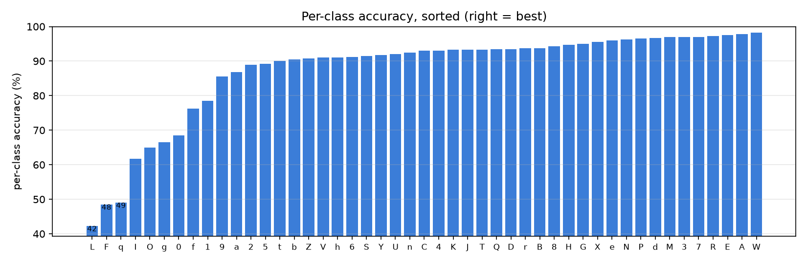

排序后最差的几类：**L 42.2%、F 48.5%、q 49.0%、I 61.8%、O 65.0%**，
而最好的 W / A / E / R / M 都在 97% 以上。差的不是模型，是**标注本身的模糊性**：

- 手写的 `L` 在 NIST 19 里经常就是一根竖线，和 `1`、`I`、`l` 视觉上完全一样；
- `F` 和 `f`、`O` 和 `0`、`q` 和 `9` 同理；
- balanced 子集合并了"写法完全相同"的大小写，但**没合并"经常写得一样"的**。

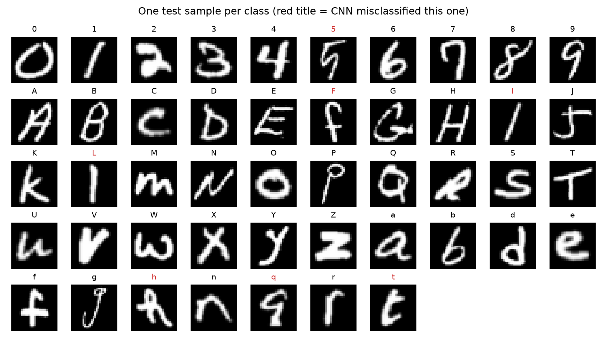

这张图就是证据：`L` 那张样本是一根斜竖线，`I` 是一根斜竖线，`F` 和 `f` 是同一个十字架造型。
**你让一个人来看也分不出**，所以 87% 里损失的 13 个点，有一大半是数据集的上限，不是你的 bug。

这也解释了为什么 47 类任务的天花板远低于 10 类：**这不是"同一个任务加了 37 个类"，
而是"加了 37 个彼此高度相似的类"**。真实 OCR 系统正是靠"区分大小写/易混字符"这类
细粒度问题决定成败，也正是在这类地方开始需要更强的结构（两层卷积、注意力、语言模型后处理）。

## 14. 再上一档：CIFAR-10，彩色 32×32，10 类

前面用过的 MNIST / EMNIST 有一个共同点：**灰度、单个物体、背景干净、几乎摆正**。CIFAR-10 不是：
32×32 的彩色照片，狗趴在草地上、船浮在海面上、飞机在云里，同一个类内部的颜色、姿态、
背景差异巨大，而且 32×32 小到一只猫只剩十几个可辨认的像素。

网络代码几乎不用改：`nn.py` 一行不动，`conv.py` 只是多了一个能堆叠的 `DeepCNN`
（`Conv2D` 加了 `pad` 参数，因为 3×3 卷积不加 padding 会把 32×32 越卷越小）。
真正的工作量全在**数据**上——这也是这一节最值得记住的一句话：
**换数据集时，八成的时间花在把数据喂对，而不是在调模型。**

```bash
uv run python cifar10.py                 # 先看一眼数据：形状、通道、类别是否均衡
uv run python step8_train_cifar10.py     # MLP 6 轮 + CNN 12 轮，约 26 分钟（M1 Pro）
```

### 14.1 四个必须处理的坑

**坑 1：pickle 里是 `(N, 3, 32, 32)`，不是 `(N, 32, 32, 3)`。**
每张图的 3072 个字节是"先 1024 个 R、再 1024 个 G、再 1024 个 B"排的。直接
`reshape(32, 32, 3)` 出来，你会得到一张红绿蓝三块拼在一起的图；`transpose(0, 2, 3, 1)`
才把它变成"每个像素三个数挨着"的 NHWC 布局。`cifar10.py` 里那一行就是全部。

**坑 2：`float32` 求均值会给你一个假数。**
50000×32×32×3 = 1.5 亿个数，用 float32 累加，numpy 算出来的三通道均值是
`0.32768 / 0.32768 / 0.32768`——**三通道一模一样，这本身就是破绽**。真实值是
`0.4914 / 0.4822 / 0.4465`（和 CIFAR 官方给的均值对得上）。加上 `dtype=np.float64`
就正常了。症状很隐蔽：训练照样能跑、loss 照样降，只是输入没被真正居中，前几轮慢半拍。
**凡是"上亿个数求统计量"，一律指定 float64。**

**坑 3：必须按通道标准化，且统计量只能来自训练集。**
三个通道的分布不同、相关性强，不标准化时第一层卷积要花好几个 epoch 才能把输入拉到
同一量级。`cifar10.normalize()` 返回 `mean/std`，训练脚本把它同时用在训练集和测试集上——
用测试集的统计量就是信息泄漏。

**坑 4：必须做数据增强，否则测试集很快就会卡住。**
`random_crop_flip` 先四周补 4 像素、再随机裁回 32×32（相当于让物体随机平移 ±4 像素），
再加 50% 概率的水平翻转。不增强时，模型会把"物体在画面里的绝对位置"一起背下来：
训练集准确率一路涨，测试集早早卡住（`--augment 0` 跑一遍就能看到这个典型的过拟合形状）。
增强之后它才被迫学"物体是什么形状，而不是在哪儿"。这是 CIFAR 上最便宜、也最有效的
一招，比换网络结构划算得多。

**新的体检基准**：10 类还是 `ln(10) ≈ 2.30`，但实测初始 loss 是 **3.90**，明显偏高。
原因是 3 个通道的像素高度相关，He 初始化假设输入各维独立，实际第一层的有效方差更大，
logits 一开始就偏大、softmax 过早自信。它不是 bug，但能解释为什么"开局 loss 比 ln K 高"
在彩色图上很常见——同理也是 BatchNorm 想解决的问题。

### 14.2 结果：卷积把 49.69% 推到 76.87%

| 模型                                                | 参数量    | CIFAR-10 测试准确率 | 每轮耗时 |
| --------------------------------------------------- | --------- | ------------------- | -------- |
| MLP 3072-512-10（直接展平）                         | 1,578,506 | **49.69%**    | ~15.6 s  |
| DeepCNN conv3x3(32)→pool→conv3x3(64)→pool→fc256 | 1,070,794 | **76.87%**    | ~130 s   |

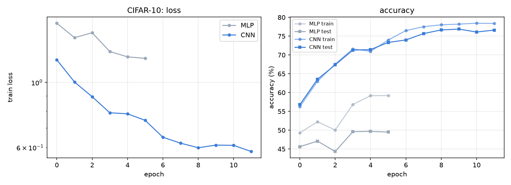

**同一个数据集，卷积多拿 27.2 个点，参数量还少 50.7 万。** 这是整篇文档里对比最强烈的一组数字，
原因也很直白：MLP 把 3072 维当成 3072 个互不相关的数，于是它只能学"某几个固定位置上的像素组合"；
物体一平移、一换个姿势，这套模板就失效。而卷积只关心"局部的小图案出现在哪、以什么组合出现"，
平移不变性直接写进了结构里。

MLP 那 49.69% 也值得看一眼：train 59.2% / test 49.7%，差了近 10 个点——158 万参数（比 CNN 还多）在 5 万张图上
已经开始过拟合了，这也解释了为什么它怎么调都上不去。

### 14.3 错在哪：全是"邻居"

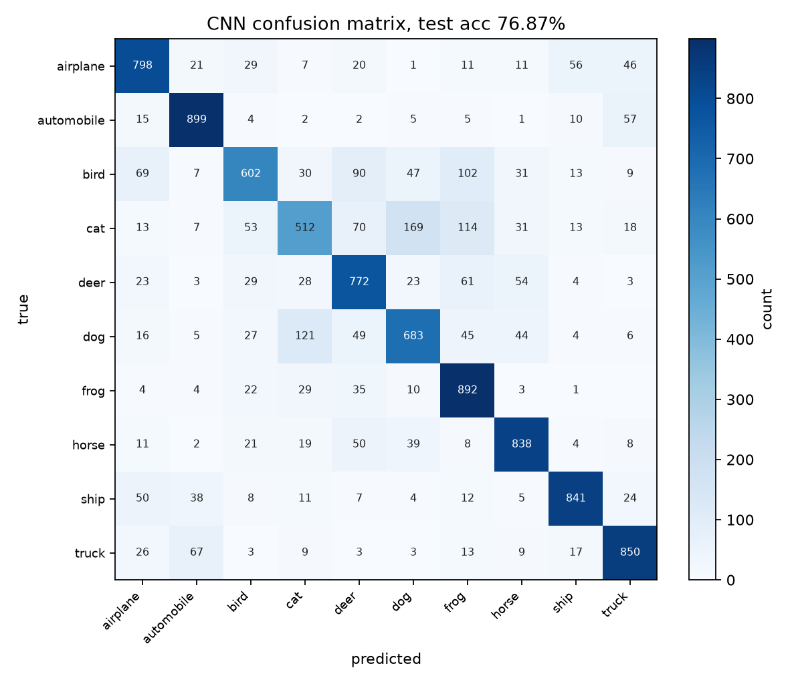

只错在相邻的类上，前 8 名（真→预测）：

```
cat→dog 169   dog→cat 121   cat→frog 114   bird→frog 102
bird→deer 90  cat→deer 70   bird→airplane 69  truck→automobile 67
```

`cat↔dog` 几乎是双向的（169 + 121），`truck↔automobile` 是"都是四个轮子的车"，
`bird→frog/deer` 则是"绿色背景里的一小团东西"。这里的错误不是模型学崩了，
而是**在 32×32 的分辨率下，这些类真的没有足够的视觉证据**。给任何一个人看 32×32 的
猫和狗，答案也常常是猜的。

### 14.4 哪几类天生难

| 最容易     | 准确率 | 最困难 | 准确率          |
| ---------- | ------ | ------ | --------------- |
| automobile | 89.9%  | cat    | **51.2%** |
| frog       | 89.2%  | bird   | 60.2%           |
| truck      | 85.0%  | dog    | 68.3%           |
| ship       | 84.1%  | deer   | 77.2%           |

规律很清晰：**有稳定整体形状 + 稳定背景的类容易**（汽车是方盒子、船总在水上、青蛙通体绿色），
**靠纹理和姿态区分的类难**（猫可以躺着、趴着、只露个背影；鸟的体型跨度比青蛙还大）。
猫的 51.2% 基本等于"十类里蒙中一个再稍微好一点"，说明这个类别上模型真正学到的东西最少。

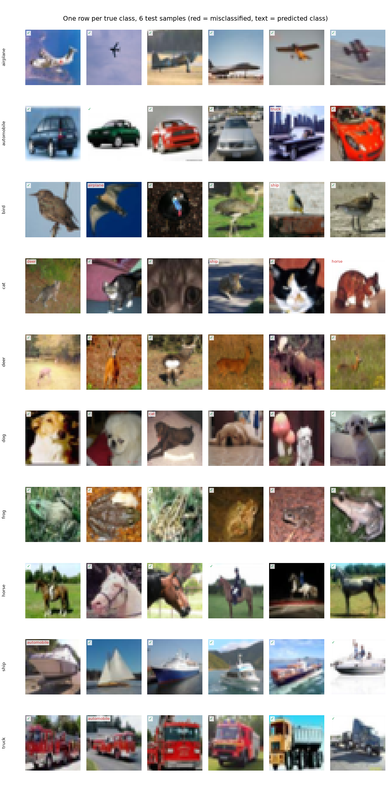

### 14.5 第一层到底在看什么

3×3 的卷积核本身只是 9 个像素的颜色组合，单独画出来就是一堆彩色噪点，没什么信息量——
**有意义的是它对图像的响应**。下面是同一张船图经过第一层 32 个卷积核之后的 32 张特征图：

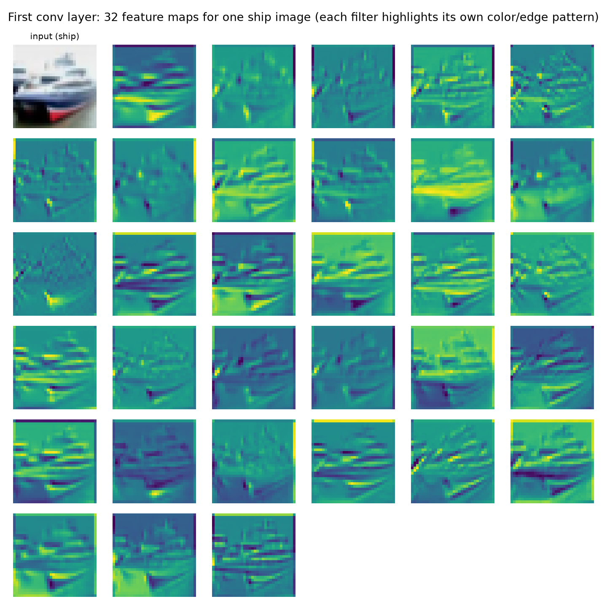

有的核在强调天空和海面的水平分界，有的在强调船体的斜边，有的基本只对某种颜色有反应。
这些特征还很"底层"，但它们已经是后面那层卷积拼出"船"这个概念的原料。

### 14.6 76.87% 比 99.12% 更值钱的原因

MNIST 上 99% 是"洗干净、摆正、居中"的数据，考的是实现细节；CIFAR 上 76% 考的是
**对真实数据的理解**：像素怎么排、统计量怎么算、要不要增强、网络怎么堆。
真实业务里的数据永远长成 CIFAR 这样，而不是 MNIST 那样。

想再往上走，路子都在这个闭环里加东西，而不是换框架：
**BatchNorm**（让深一点的网络也能训）、**更深的 VGG/残差**（感受野更大）、
**更强的增强**（Cutout / MixUp）、**更多 epoch + 余弦退火**。
这套 NumPy 实现跑 12 轮要 26 分钟，所以本节停在 76.87%——不是能力上限，是耐心上限。

## 附录 A：公式速查

**前向**

```
z1 = X@W1 + b1      a1 = relu(z1)      z2 = a1@W2 + b2
p  = softmax(z2)    L  = -mean(log p[i, y_i])
```

**反向**（从上到下，方向与"求梯度"相同）

```
G2  = (p - Y)/N                       # softmax+CE，一步到位
dW2 = a1.T@G2         db2 = G2.sum(0)  # 参数梯度
G1  = (G2@W2.T) * (z1 > 0)            # 穿过 Linear，再穿过 ReLU
dW1 = X.T@G1          db1 = G1.sum(0)
```

**卷积版**（`cols` 是 im2col 之后的 `(N*oh*ow, k*k*C)`）

```
cols = im2col(X)                 # (N*oh*ow, k*k*C)
out  = cols @ W + b              # (N*oh*ow, F) -> reshape (N,oh,ow,F)
dW   = cols.T @ G                # 与全连接 dW = X.T@G 同构
db   = G.sum(0)
dX   = col2im(G @ W.T)           # 关键：重叠位置要 "+=" 累加
dpool: 只把 G 放回正向 argmax 的位置
```

**形状自查**：每一个 `dW` 的形状必须和对应的 `W` 一模一样。对不上就是转置写反了，
这是排查反向传播最快的办法。

**数值**：`ln(10) = 2.303`（初始 loss 基准）；`softmax` 先减 max；梯度检验用 `eps=1e-4~1e-6`、float64。

---

## 附录 B：数据流全景

```
data/mnist/*.gz
   │  mnist.py：gzip 解压 → struct 读头 → reshape → /255
   ▼
X(60000,784) float32, y(60000,) int64
   │  step3：permutation → 切片成 (64,784)
   ▼
Linear(784→256) → ReLU → Linear(256→10) → Softmax+CE
   ▲                                   │
   └──── backward：G 逐层回传 ◄─────────┘
   │  Adam.step()：θ -= lr * m̂/(√v̂+ε)
   ▼
models/mlp_mnist.npz  →  step4 可视化 / predict_image 推理
```

卷积版本（第 12 节）在这一支上分叉：

```
X(60000,784) ──reshape──> (60000,28,28,1)
   │  shift_augment：随机平移 ±2 像素（只对训练集）
   ▼
Conv2D(1→32, 5x5) → ReLU → MaxPool2(2x2) → Flatten
   ▼
Linear(4608→128) → ReLU → Linear(128→10) → Softmax+CE
   ▲   im2col / col2im 在 Conv2D 内部完成，反向公式复用附录 A
   │
   ▼
models/cnn_mnist.npz（最佳 99.12%，第 8 轮）
```

CIFAR-10（第 14 节）在这一支上再分叉一次：

```
data/cifar10/cifar10.npz（50k 训练 + 10k 测试，uint8 缓存）
   │  cifar10.py：(N,3,32,32) -> transpose -> (N,32,32,3)；normalize 用 float64 求信道均值
   ▼
X(50000,32,32,3) float32，标准化后均值≈0
   │  random_crop_flip：补 4 像素 → 随机裁 32×32 → 50% 水平翻转（只对训练集）
   ▼
Conv2D(3→32, 3x3, pad=1) → ReLU → MaxPool2 → Conv2D(32→64, 3x3, pad=1) → ReLU → MaxPool2
   ▼
Flatten(64*8*8=4096) → Linear(4096→256) → ReLU → Linear(256→10) → Softmax+CE
   ▼
models/cnn_cifar10.npz（最佳 76.87%，第 10 轮）
```

跑完这一套，你手上就有了一个"从像素到概率、从损失到梯度、从梯度到参数"的完整闭环。
剩下的所有深度学习内容，都是在这个闭环上加东西：换层、换损失、换优化器、换数据。
